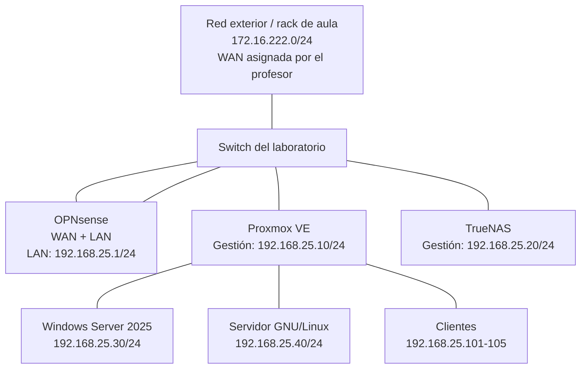

# Infraestructura de sistemas de una empresa — Proyecto ISO + FHW

> **Estado:** diseño y documentación inicial. Los valores marcados como `PENDIENTE` deben sustituirse por los datos reales obtenidos durante el montaje y las pruebas.  
> **Red LAN del proyecto:** `192.168.25.0/24`.


## 1. Objetivo

Diseñar, desplegar, administrar y documentar una infraestructura informática empresarial de laboratorio. El entorno contempla:

- **Proxmox VE:** plataforma de virtualización para alojar servidores y clientes virtuales.
- **OPNsense:** servidor de comunicaciones, cortafuegos, NAT y puerta de enlace entre la red de laboratorio y la red exterior autorizada.
- **TrueNAS:** almacenamiento centralizado para compartir datos y guardar copias de seguridad.
- **Windows Server 2025:** servidor de dominio e identidad (si se implanta en esta fase).
- **Servidores GNU/Linux y clientes:** servicios de infraestructura y equipos de los distintos departamentos.

El objetivo no es afirmar que la infraestructura es redundante o de alta disponibilidad sin haberlo probado. Se documentarán los recursos disponibles, las limitaciones del laboratorio y las recuperaciones verificadas.

## 2. Alcance y criterios

1. Inventariar el hardware real antes de asignar recursos.
2. Justificar los sistemas elegidos según función, requisitos, licencias, soporte y compatibilidad.
3. Diseñar la topología física y lógica.
4. Instalar y configurar Proxmox, OPNsense y TrueNAS.
5. Crear las máquinas virtuales necesarias.
6. Verificar conectividad, filtrado, almacenamiento, copias y recuperación.
7. Registrar incidencias, evidencias y decisiones con Git.

**Importante sobre el direccionamiento:** este repositorio utiliza `192.168.25.0/24` como LAN del entorno. La actividad de clase describe una red exterior/rack compartida `172.16.222.0/24` y advierte que la WAN debe ser asignada por el profesorado. No se debe inventar una IP WAN ni activar un servidor DHCP en la red compartida. Confirmar con el profesor que `192.168.25.0/24` es el rango asignado al grupo/entorno antes de conectar el equipo al rack.

## 3. Arquitectura propuesta



> El diagrama es lógico y simplificado. En el montaje real, OPNsense debe disponer de dos interfaces de red diferenciadas: WAN y LAN. La LAN debe conectarse al switch interno. Si OPNsense está virtualizado en Proxmox, hay que configurar correctamente los bridges y evitar exponer la administración de Proxmox a la WAN. No conectar WAN y LAN al mismo segmento sin un diseño deliberado.

### 3.1. Componentes

| Componente | Función | Tipo | Estado |
|---|---|---|---|
| Proxmox VE | Hipervisor y gestión de VM/CT | Físico o VM de laboratorio | PENDIENTE |
| OPNsense | Firewall, routing y NAT | VM con 2 NIC o equipo dedicado | PENDIENTE |
| TrueNAS | NAS, datasets y comparticiones | Equipo dedicado o VM de pruebas | PENDIENTE |
| Windows Server 2025 | AD DS, DNS y políticas, si procede | VM | PENDIENTE |
| GNU/Linux | Servicios de infraestructura | VM | PENDIENTE |
| Clientes Windows/Linux | Pruebas de acceso y servicios | VM/equipo físico | PENDIENTE |
| Switch | Interconexión LAN | Físico | PENDIENTE |

## 4. Plan de direccionamiento IP

Máscara de la LAN: `255.255.255.0` (`/24`)  
Red: `192.168.25.0/24`  
Broadcast: `192.168.25.255`  
Puerta de enlace de los equipos LAN: `192.168.25.1`  
DNS: inicialmente `192.168.25.1` (OPNsense) o el DNS del dominio cuando Windows Server esté configurado. Documentar el cambio cuando se realice.

| Equipo/interfaz | Dirección IP | Máscara | Puerta de enlace | Asignación |
|---|---:|---|---:|---|
| OPNsense LAN | `192.168.25.1` | `/24` | — | Estática |
| Proxmox gestión (`vmbr0` o bridge LAN) | `192.168.25.10` | `/24` | `192.168.25.1` | Estática |
| TrueNAS gestión | `192.168.25.20` | `/24` | `192.168.25.1` | Estática |
| Windows Server 2025 | `192.168.25.30` | `/24` | `192.168.25.1` | Estática |
| Servidor GNU/Linux | `192.168.25.40` | `/24` | `192.168.25.1` | Estática |
| Cliente Dirección | `192.168.25.101` | `/24` | `192.168.25.1` | DHCP/reserva o estática |
| Cliente Administración | `192.168.25.102` | `/24` | `192.168.25.1` | DHCP/reserva o estática |
| Cliente Comercial | `192.168.25.103` | `/24` | `192.168.25.1` | DHCP/reserva o estática |
| Cliente Producción | `192.168.25.104` | `/24` | `192.168.25.1` | DHCP/reserva o estática |
| Cliente Informática | `192.168.25.105` | `/24` | `192.168.25.1` | DHCP/reserva o estática |
| WAN OPNsense | `PENDIENTE: asignada por profesor` | Según asignación | Según asignación | Según profesor |

**Reglas de direccionamiento:**
- Reservar `.1` para la puerta de enlace.
- Reservar `.2–.9` para futuras interfaces/servicios de red.
- Usar `.10–.49` para infraestructura y servidores.
- Usar `.50–.99` para crecimiento y pruebas.
- Usar `.100–.199` para clientes.
- No duplicar direcciones. Mantener un inventario actualizado.
- Si se activa DHCP en OPNsense, usar por ejemplo `192.168.25.100–192.168.25.199`, excluyendo las IP estáticas/reservadas. Ajustar el rango si se usan IP fijas para los clientes.
- No ejecutar DHCP en la WAN ni en el segmento compartido del aula.

## 5. Diseño de virtualización

### 5.1. Proxmox VE

Proxmox VE será el hipervisor principal. Desde su interfaz web se administrarán las máquinas virtuales y contenedores.

| Parámetro | Valor previsto |
|---|---|
| Nombre del host | `pve01` |
| IP de gestión | `192.168.25.10/24` |
| Gateway | `192.168.25.1` |
| FQDN | `pve01.empresa.test` (propuesta de laboratorio) |
| CPU/RAM/Disco | PENDIENTE según inventario |
| Almacenamiento local | PENDIENTE |
| Bridge LAN | PENDIENTE de topología física |
| Versión instalada | PENDIENTE |

No se debe asignar toda la RAM ni todos los núcleos a las VM: reservar recursos para el propio hipervisor. No habilitar clúster/HA si solo existe un nodo. Un clúster requiere varios nodos y sus requisitos de quorum, red y almacenamiento deben justificarse y probarse.

### 5.2. Máquinas virtuales previstas

| ID | Nombre | Sistema | Función | vCPU | RAM | Disco | IP |
|---:|---|---|---|---:|---:|---:|---|
| 100 | `fw01` | OPNsense | Firewall/router | PEND. | PEND. | PEND. | LAN `.1`; WAN asignada |
| 101 | `nas01` | TrueNAS SCALE/CORE | Almacenamiento | PEND. | PEND. | PEND. | `.20` |
| 102 | `dc01` | Windows Server 2025 | AD DS/DNS | PEND. | PEND. | PEND. | `.30` |
| 103 | `srv01` | Debian GNU/Linux | Servicios de infraestructura | PEND. | PEND. | PEND. | `.40` |
| 110 | `cli-dir` | Windows 11/Linux | Cliente Dirección | PEND. | PEND. | PEND. | `.101` |
| 111 | `cli-adm` | Windows 11/Linux | Cliente Administración | PEND. | PEND. | PEND. | `.102` |

Los recursos son valores pendientes: se decidirán tras comprobar CPU, RAM y almacenamiento del equipo anfitrión. Registrar el consumo real y cuántas VM pueden ejecutarse simultáneamente sin degradación.

### 5.3. Bridges y NIC

La configuración final depende de si OPNsense se instala en un equipo físico o como VM:

- **OPNsense físico:** una NIC para WAN y otra para LAN como mínimo.
- **OPNsense virtual:** asignar dos NIC virtuales a la VM. Una conectada al segmento WAN autorizado y otra al bridge LAN interno.
- **Proxmox:** la interfaz de gestión debe permanecer en la LAN de administración; no exponer `8006/TCP` a la WAN.
- **TrueNAS virtualizado:** para ZFS y pruebas de discos, preferir discos físicos pasados directamente a la VM cuando el hardware y el profesor lo permitan. No considerar un único disco virtual como redundancia real.

Registrar el mapa real de NIC, bridges, puertos físicos y cables en `docs/04-red.md`.

## 6. OPNsense — servidor de comunicaciones

### Funciones previstas
- Enrutamiento entre LAN y WAN.
- NAT de salida para permitir que la LAN acceda al exterior cuando esté autorizado.
- Filtrado de tráfico mediante reglas de firewall.
- DHCP para clientes LAN, si se decide centralizarlo en OPNsense.
- DNS resolver/forwarder, si se utiliza.
- Registros de conexiones y eventos.

### Configuración de red prevista

| Interfaz | Nombre lógico | Dirección |
|---|---|---|
| WAN | `WAN` | PENDIENTE: asignación del profesor en `172.16.222.0/24` |
| LAN | `LAN` | `192.168.25.1/24` |

### Política inicial de firewall (propuesta)

1. Permitir desde LAN la administración del firewall solo desde el equipo de administración.
2. Permitir DNS y DHCP necesarios para los clientes.
3. Permitir conexiones salientes LAN→WAN necesarias para las pruebas.
4. Bloquear conexiones entrantes WAN→LAN por defecto.
5. No publicar interfaces de administración hacia Internet/WAN.
6. Registrar los bloqueos relevantes para poder demostrar las pruebas.

Las reglas definitivas se documentarán con origen, destino, protocolo, puerto, acción y justificación. Antes de modificar reglas, guardar una copia de configuración y disponer de acceso de recuperación.

## 7. TrueNAS — almacenamiento centralizado

### Funciones previstas
- Almacenamiento compartido para documentos de prueba.
- Datasets separados por uso/departamento.
- Compartición SMB para clientes Windows y, si procede, NFS para GNU/Linux.
- Destino de copias de seguridad de configuraciones y datos críticos.
- Cuotas y permisos cuando se hayan definido usuarios y necesidades.

### Configuración prevista

| Parámetro | Valor |
|---|---|
| Hostname | `nas01` |
| IP | `192.168.25.20/24` |
| Gateway | `192.168.25.1` |
| DNS | `192.168.25.1` o DNS del dominio |
| Pool | PENDIENTE según discos disponibles |
| Datasets | `empresa`, `backups`, `isos` |
| Protocolo | SMB y/o NFS |
| Usuarios/grupos | PENDIENTE |

**Advertencia:** RAID/ZFS no sustituye a una copia de seguridad. Si solo hay un disco, documentarlo como limitación y no afirmar que existe redundancia. No crear un pool con discos que contengan datos que deban conservarse. Antes de realizar cambios destructivos, verificar discos y disponer de autorización.

## 8. Servicios y clientes

### Windows Server 2025
Si se despliega AD DS:
- Nombre: `dc01`
- IP: `192.168.25.30/24`
- Dominio de laboratorio: `empresa.test` (nombre reservado para pruebas; confirmar que no se utiliza en una red real).
- DNS integrado en Active Directory.
- Crear usuarios y grupos de prueba, unidades organizativas y políticas según alcance.

No configurar el DNS de los clientes hacia el servidor de dominio hasta que DNS/AD estén operativos.

### GNU/Linux
Servidor previsto: `srv01`, `192.168.25.40/24`. La función concreta (por ejemplo, monitorización, syslog, DNS secundario o servicio web interno) se decidirá y justificará en `docs/03-sistemas.md`.

### Clientes
Los clientes representarán los departamentos de Dirección, Administración, Comercial, Producción e Informática. Se probará:
- Obtención de IP y resolución DNS.
- Acceso a recursos SMB/NFS según permisos.
- Acceso permitido y bloqueado a través de OPNsense.
- Integración en dominio, si se implementa.
- Restauración de archivos de prueba.

## 9. Almacenamiento, copias y recuperación

### Qué se debe respaldar
- Exportación de configuración de OPNsense.
- Configuración de Proxmox y documentación de inventario/red.
- Copias de seguridad de VM/CT importantes.
- Configuración de servicios y datos empresariales de prueba.
- Configuración y datos relevantes de TrueNAS, con destino independiente cuando sea posible.

### Qué no debe confundirse
- Snapshot: punto de retorno rápido, normalmente dependiente del mismo almacenamiento.
- Backup: copia recuperable, preferiblemente en un destino independiente.
- RAID/ZFS mirror: continuidad ante ciertos fallos de disco, no protege frente a borrado, ransomware o fallo del equipo completo.

### Plan mínimo de pruebas

| Prueba | Método | Resultado esperado | Evidencia |
|---|---|---|---|
| Backup OPNsense | Exportar configuración | Archivo guardado en destino seguro | Captura/archivo sin secretos |
| Backup VM | Backup desde Proxmox | Tarea finalizada correctamente | Log de tarea |
| Restauración | Restaurar VM de prueba | VM arranca y servicio responde | Capturas y prueba funcional |
| SMB | Crear/leer archivo desde cliente autorizado | Acceso según permisos | Captura |
| Fallo simulado | Apagar VM o desconectar NIC virtual asignada | Detectar pérdida del servicio | Registro |
| Recuperación | Restaurar o reactivar recurso | Servicio vuelve a funcionar | Tiempo y comprobación |

Definir objetivos de recuperación como objetivos del ejercicio (RTO: tiempo máximo de recuperación; RPO: pérdida máxima de datos aceptable) y después registrar los valores observados. No declarar alta disponibilidad si no se ha probado.

## 10. Seguridad y administración

- Usar contraseñas únicas y robustas; no subirlas a GitHub.
- No subir claves privadas, tokens, ficheros `.conf` de VPN, volcados de contraseñas ni copias que contengan secretos.
- Crear usuarios administrativos nominativos cuando sea posible y limitar el uso de `root`/administrador.
- Actualizar los sistemas desde repositorios oficiales y registrar fecha/versión.
- Restringir la administración de Proxmox, TrueNAS y OPNsense a la red/equipo de gestión.
- Mantener registros de cambios y evidencias sin datos sensibles.
- Hacer pruebas de firewall solo en la red de laboratorio autorizada.

## 11. Plan de trabajo

| Fase | Actividad | Entregable |
|---|---|---|
| 1 | Predicciones, requisitos y objetivos | `docs/00-predicciones.md`, `docs/01-requisitos.md` |
| 2 | Inventario de hardware y software | `docs/02-inventario.md`, `docs/03-sistemas.md` |
| 3 | Topología física y lógica | `docs/04-red.md`, `diagramas/` |
| 4 | Instalación Proxmox, OPNsense y TrueNAS | `docs/05-instalacion.md` |
| 5 | VM, servicios y clientes | `docs/06-servicios.md` |
| 6 | Almacenamiento y backups | `docs/07-backups-recuperacion.md` |
| 7 | Monitorización y pruebas | `docs/08-verificacion.md` |
| 8 | Incidencias y conclusiones | `docs/09-incidencias.md`, `docs/10-conclusiones.md` |

## 12. Estructura del repositorio

```text
iso-fhw-empresa/
├── README.md
├── docs/
│   ├── 00-predicciones.md
│   ├── 01-requisitos.md
│   ├── 02-inventario.md
│   ├── 03-sistemas.md
│   ├── 04-red.md
│   ├── 05-instalacion.md
│   ├── 06-servicios.md
│   ├── 07-backups-recuperacion.md
│   ├── 08-verificacion.md
│   ├── 09-incidencias.md
│   └── 10-conclusiones.md
├── diagramas/
│   └── topologia.md
└── evidencias/
    └── README.md
```

## 13. Fuentes oficiales

Consultar y anotar la fecha de consulta de cada fuente:
- Proxmox VE: https://www.proxmox.com/en/products/proxmox-virtual-environment/overview
- Documentación Proxmox: https://pve.proxmox.com/pve-docs/
- OPNsense: https://opnsense.org/
- Documentación OPNsense: https://docs.opnsense.org/
- TrueNAS: https://www.truenas.com/
- Documentación TrueNAS: https://www.truenas.com/docs/
- Windows Server: https://learn.microsoft.com/windows-server/

## 14. Registro de cambios

| Fecha | Autor | Cambio | Verificación |
|---|---|---|---|
| PENDIENTE | PENDIENTE | Creación de la documentación inicial | PENDIENTE |

---

**Nota de rigor:** completar cada apartado con capturas, comandos, resultados reales y decisiones propias. No dejar como hecho ningún elemento que solo esté diseñado o simulado.
